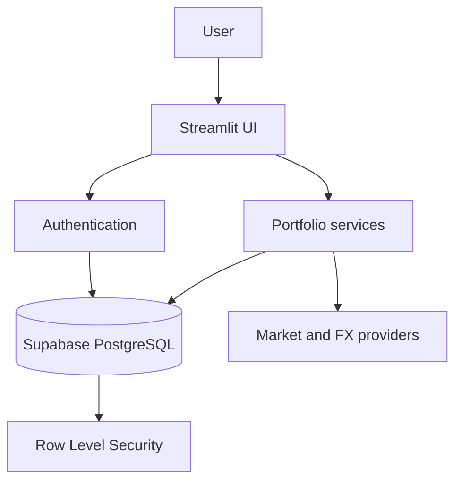

# Personal Asset Dashboard

[](https://www.python.org/)
[](https://streamlit.io/)
[](https://supabase.com/)
[](https://github.com/HLin34/Personal_Asset_Dashboard_Demo/actions/workflows/tests.yml)

A security-focused, multi-currency personal asset management application built with **Python, Streamlit, and Supabase**. The project consolidates accounts, investments, transactions, insurance policies, market prices, foreign-exchange rates, and portfolio performance in one dashboard.

> **Portfolio edition:** this public repository contains application code and tests for technical review. Production data, credentials, database backups, deployment secrets, and environment-specific database configuration are intentionally excluded.

## Highlights

- Multi-currency portfolio valuation with configurable base currency
- Cash, stocks, ETFs, funds, bonds, and cryptocurrency tracking
- Transaction workflows for trades, dividends, fees, taxes, deposits, and withdrawals
- Time-weighted return (TWR), XIRR, cost basis, snapshots, and benchmark analytics
- External market-price and foreign-exchange integrations
- Structured CSV import/export with validation and normalization
- Supabase authentication and user-scoped data access
- Modular service layer with automated unit tests

## Architecture



The UI is separated from calculation and data-service modules. Supabase provides authentication and PostgreSQL storage; Row Level Security is the final authorization boundary for user-owned records.

## Core Modules

| Area | Capabilities |
|---|---|
| Accounts | Financial institutions, accounts, archive lifecycle |
| Assets | Asset master data, holdings, pricing source configuration |
| Transactions | Trades, dividends, corporate actions, broker fees, cash flows |
| Analytics | Valuation, cost basis, TWR, XIRR, benchmarks, snapshots |
| Insurance | Policy inventory, groups, benefits, reference values |
| Data portability | Validated CSV imports and structured exports |

## Technology

- **Frontend:** Streamlit, Plotly, Altair
- **Backend:** Supabase Auth, PostgreSQL, Row Level Security
- **Data:** Pandas, OpenPyXL
- **Market data:** yfinance and provider-specific integrations
- **Testing:** Python `unittest`, GitHub Actions
- **Runtime:** Python 3.11

## Security Design

- Runtime credentials are loaded from Streamlit secrets and are never committed.
- The client uses only a Supabase publishable/anon key—never a service-role key.
- Every query is scoped to the authenticated user, while database RLS provides defense in depth.
- Production financial data, exports, backups, import batches, and local Supabase state are ignored.
- The production security audit verified RLS on all 17 public tables and identity checks across 40 policies.

See [Security notes](docs/SECURITY.md) for the public-release boundary and secure configuration guidance.

## Project Structure

```text
app.py                         # Streamlit entry point
auth.py                        # Authentication UI and session handling
dashboard.py                   # Main application navigation
features/                      # Streamlit feature pages
features/transactions/         # Trade and cash-flow workflows
services/                      # Valuation, returns, import/export, market data
tests/                         # Unit tests for financial and import logic
.streamlit/secrets.toml.example
```

## Local Setup

1. Create and activate a Python 3.11 environment.
2. Install dependencies:

   ```bash
   pip install -r requirements.txt
   ```

3. Copy the example secrets file:

   ```bash
   cp .streamlit/secrets.toml.example .streamlit/secrets.toml
   ```

4. Add your own Supabase project URL and **publishable/anon** key.
5. Start the application:

   ```bash
   streamlit run app.py
   ```

A compatible Supabase schema and user-scoped RLS policies are required. Production migrations and environment-specific configuration are not included in this portfolio repository.

## Tests

```bash
python -m unittest discover -s tests -v
```

The included tests cover representative portfolio cost-basis calculations and standardized CSV-import behavior.

## Public Repository Scope

This repository is designed to demonstrate application architecture, financial-domain modeling, data-processing workflows, and secure engineering practices. It is not connected to the production database or the private deployed application.

No license is granted for reuse unless one is added later.
