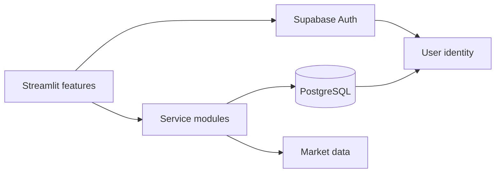
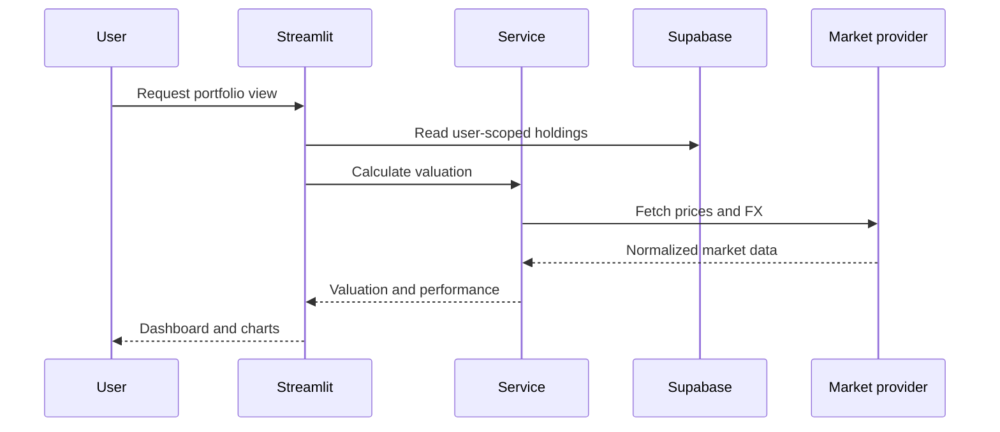

# Architecture

## Overview

The application follows a lightweight layered structure suited to Streamlit:

1. **Presentation layer** — feature pages render forms, tables, and analytics.
2. **Application services** — modules implement valuation, returns, snapshots, imports, exports, and market-data logic.
3. **Data access** — Supabase client calls persist and retrieve user-owned records.
4. **Authorization boundary** — Supabase Auth and PostgreSQL Row Level Security isolate users.

## Design choices

- Financial calculations live in service modules so they can be tested independently of the UI.
- Portfolio valuation converts positions through stored FX rates into a configurable base currency.
- Cash-flow-aware performance separates external flows from investment returns.
- Import services normalize external CSV layouts before database writes.
- Snapshots preserve point-in-time portfolio state for historical analysis.
- Database RLS provides authorization independently of Streamlit session state.

## Representative data flow

